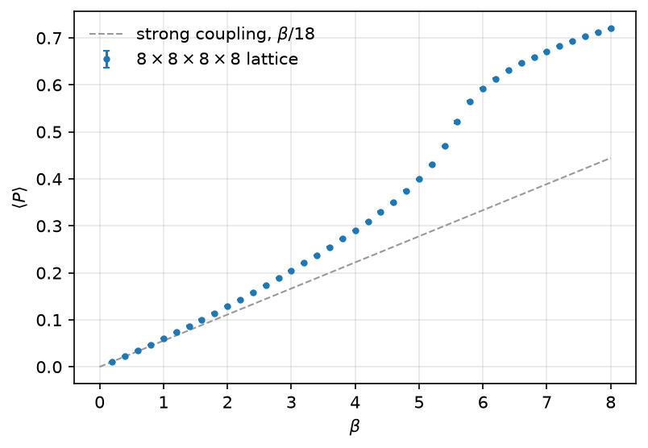

# su3-fortran

[](https://github.com/langnic/su3-fortran/actions/workflows/ci.yml)

`su3-fortran` is a simple Yang-Mills simulation code performing a beta-scan of the plaquette observable, implemented in modern Fortran with Coarrays for process-level concurrency.
It is a slightly cleaned-up project from my physics master's at the University of Wuppertal. I decided to make it available to anyone curious about lattice field theory
who might like to experiment with and extend this code.
A small analysis module in python is included. 


## Background

Lattice field theory is the discipline of studying quantum field theories on finite four-dimensional space-time lattices. The theory is discretised and evaluated numerically. SU3 gauge theory (Yang-Mills theory with three colours) describes the strong force in the absence of matter fields.

In this simulation we construct the simplest discretization of this theory using the Wilson action with periodic boundary conditions. We then compute the average plaquette energy. This is done via Markov Chain Monte Carlo (MCMC) integration -- we are approximating the integral by randomly sampling values of the integrand. This method is particularly well suited for high-dimensional integration problems. An arbitrary initial field configuration is updated repeatedly by making local changes to field variables using the **Metropolis algorithm**. This creates a so-called Markov chain of configurations, driving the field towards an equilibrium distribution resembling the physical theory.

More details about the physics can be found in the accompanying report ([`report.pdf`](report.pdf)).


## What it does

The program computes a so-called beta scan of the average plaquette. The beta parameter controls the inverse coupling strength of the theory. The beta scan shows how quantities evolve non-linearly when moving from a strongly coupled to a weakly coupled regime.

For every beta in the desired range and cadence, the program does a number of thermalization updates, followed by a number of measurements with equilibrating updates in between. The number of measurements and thermalization steps can be freely configured. The measurements are stored in a CSV file (one row per measurement), with a header containing the simulation parameters.

The included python module reads the CSV output and produces averages with their statistical uncertainties considering auto-correlations. The script outputs several plots: the beta scan, the integrated auto-correlation time per beta and (optionally) MC histories and the auto-correlation functions for every beta. 


## Results on a 8x8x8x8 lattice




Average plaquette vs. beta from `config/production.toml` (500 measurements per beta, gamma-method errors; full output in `example_output/`). At small beta the data follow the strong-coupling expansion <P> = beta/18, and around beta ~ 5.5 the crossover to weak coupling sets in. At beta = 6 we find <P> = 0.593(1), close to the literature value of about 0.594, and the shape of the curve matches Fig. 4.2 of Gattringer & Lang. Autocorrelation times are largest in the crossover region (beta ~ 5.5), where the errors are least reliable. See [`report.pdf`](report.pdf) for details.

## Build

Requires gfortran, OpenCoarrays (`caf`, `cafrun`) and BLAS (Accelerate on macOS).

```
make                # build build/su3
make test           # run the tests
```

## Run

```
make run                            # run with config/default.toml
make run CONFIG=config/small.toml   # quick 4^4 run
make run NP=4                       # number of coarray images
```

Raw measurements are written to `<output.dir>/<output.name>.csv`.

## Configuration

TOML file, see `config/default.toml` (all keys optional except `scan.beta_min`):

```toml
[lattice]    # nx, ny, nz, nt, start ("cold" | "hot")
[algorithm]  # epsilon, reunitarize_interval
[scan]       # beta_min, beta_max, beta_step
[sampling]   # thermalization_sweeps, measurements, sweeps_per_measurement
[random]     # seed (0 = from clock)
[output]     # dir, name
```

## Analysis

Requires [uv](https://docs.astral.sh/uv/).

```
make analysis-setup                  # create analysis/.venv
make analyze CSV=example_output/production.csv
make analyze CSV=... ANALYSIS_ARGS="--history --autocorr"   # optional per-beta plots
make analysis-test                   # run the analysis tests
```

Results and plots are written to `<csv stem>_analysis/`.

## Output format

The output CSVs contain `#`-prefixed header lines (`# key = value`: seed, images, lattice, epsilon, sweeps, ...), then one row per measurement with the columns `beta,measurement,plaquette,acceptance`. Only raw measurements are stored, averaging happens in the analysis. Several CSVs can be passed to `analyze.py` and are combined as replicas.

## Code layout

- `src/`: Fortran modules. `mod_gauge_field.f95` is the core (distributed link storage, operators, update); staples are written as expressions using overloaded operators (`.sel.`, `.shift.`) in `mod_metropolis.f95`. `mod_measure.f95` holds the plaquette, `mod_toml.f95`/`mod_config.f95` the config, `main.f95` the driver.
- `tests/`: Fortran tests, one program per file
- `config/`: example run configurations
- `analysis/`: Python error analysis (gamma method, [pyerrors](https://fjosw.github.io/pyerrors/pyerrors.html)) and its tests
- `example_output/`: output of a production run
- `report/`, `presentation/`, `docs/`: original lab report sources, slides, old reference plot

## Tests

`make test` runs the Fortran tests, `make test-np` repeats the distribution and Metropolis tests for 1..10 images. Checked: cold start (plaquette = 1, action = 0), hot start, links stay in SU(3), the strong-coupling limit <P> ~ beta/18, a plausible plaquette at beta = 6, correct lattice decomposition and a plaquette independent of the number of images, the TOML reader and per-image reproducible seeding. The analysis has its own pytest suite (`make analysis-test`).

## Design notes and limitations

This codebase was created in 2017 in the course of a physics master's project exercise and has only been slightly polished.
This means that there are some significant limitations. The project should be treated as a starting point, not a polished production-ready program.
Important shortcomings include:
- single-precision arithmetic
- global coarray: only one lattice instance per program (this is partly due to limitations of the coarray implementation in Fortran 2008 and could be lifted by moving to a newer version and with a moderate amount of refactoring)
- proposal uses a fixed table of random SU(3) matrices
- no multi-hit in Metropolis
- the lattice is only split along z and t, so the number of images must factor into patches that divide `nz` and `nt` (on 16^4: 1, 2, 4, 8, 16, ... work, 3, 5, 6, 7, 9, 10 do not)
- only the plaquette observable is implemented
Users of this codebase are encouraged to improve these things.


## References

- [`report.pdf`](report.pdf): lab report
- C. Gattringer, C. B. Lang, *Quantum Chromodynamics on the Lattice*, Springer (2010)
- U. Wolff, *Monte Carlo errors with less errors*, Comput. Phys. Commun. 156 (2004) 143
- F. Joswig et al., *pyerrors: a python framework for error analysis of Monte Carlo data*, Comput. Phys. Commun. 288 (2023) 108750

## License

MIT, see [`LICENSE`](LICENSE).
